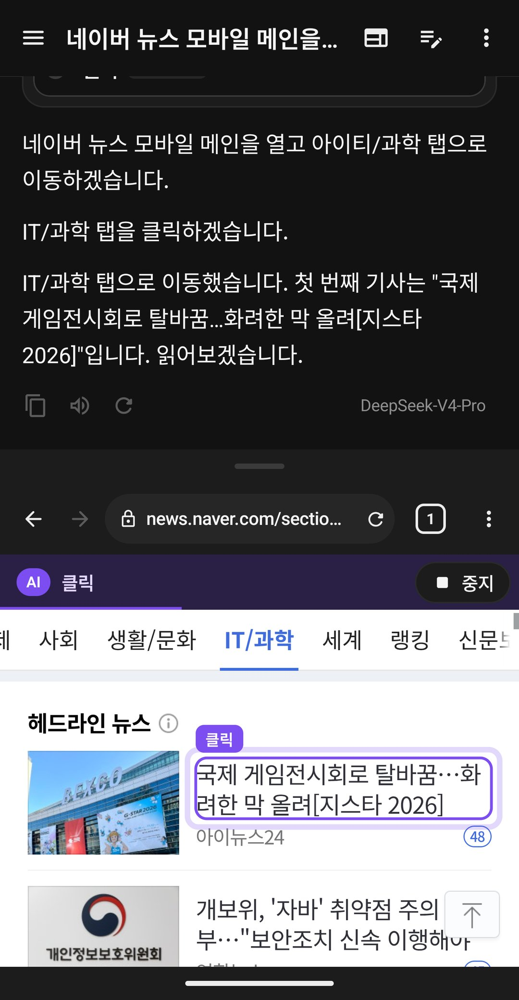
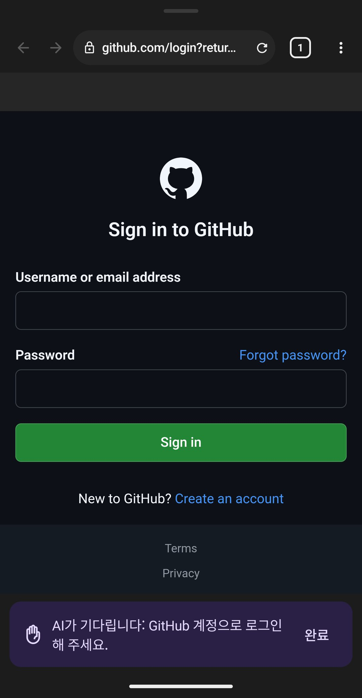
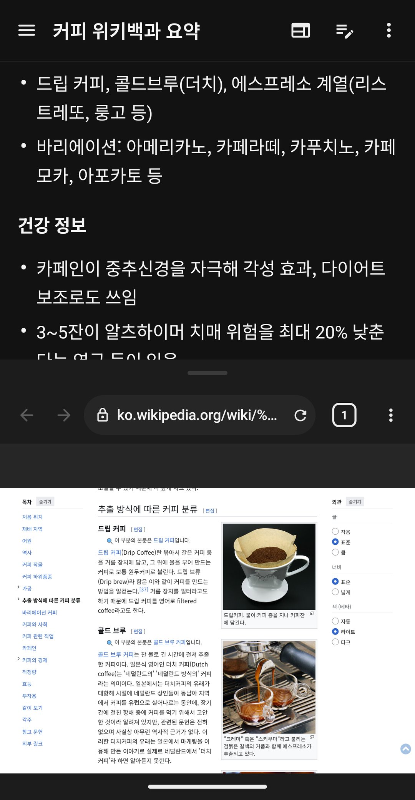
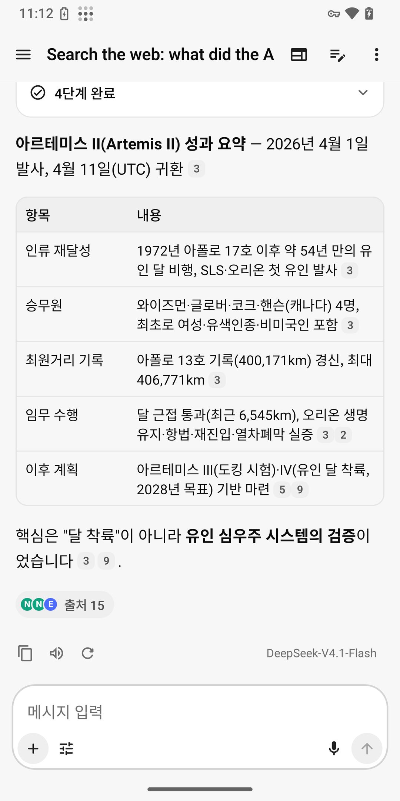
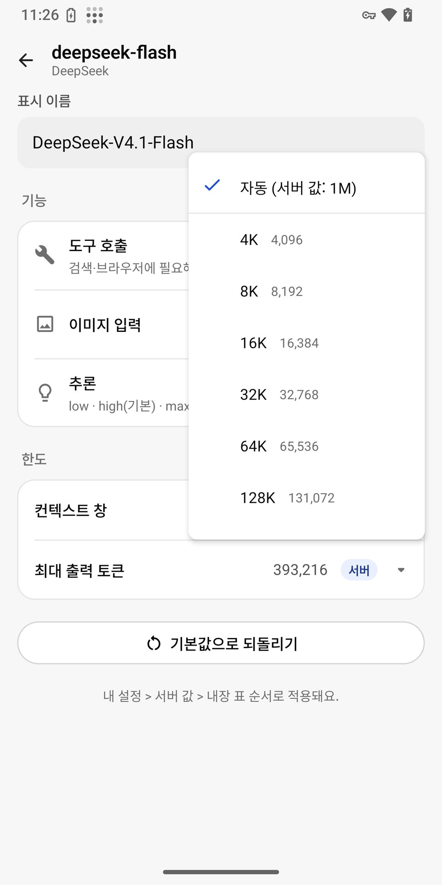

<p align="center">
  
</p>

<h1 align="center">localchat</h1>

<p align="center"><a href="README.md">English</a> · <b>한국어</b></p>

<p align="center">AI가 내 휴대폰의 실제 브라우저로 웹을 탐색하는 Android 채팅 앱.<br>로그인이 필요한 페이지는 내가 로그인해 주고, 읽고 정리하는 일은 AI가 합니다.</p>

<table>
  <tr>
    <td></td>
    <td></td>
    <td></td>
    <td></td>
    <td></td>
  </tr>
  <tr>
    <td align="center">실제 페이지 탐색</td>
    <td align="center">로그인은 내가</td>
    <td align="center">내가 보던 탭 읽기</td>
    <td align="center">검색 답변 · 출처</td>
    <td align="center">모델별 한도</td>
  </tr>
</table>

## 무엇이 다른가

### 1. 데이터센터가 아니라 내 휴대폰에서 탐색합니다
서버에서 웹을 가져오는 AI 도구는 데이터센터 IP를 쓰기 때문에 봇 차단, 캡차, 접근 거부에 자주 막힙니다.
localchat의 AI는 **내 휴대폰의 네트워크와 실제 모바일 브라우저(WebView)** 로 페이지를 엽니다.
사이트 입장에서는 휴대폰으로 들어온 평범한 방문자와 같아서, 서버형 도구가 막히는 사이트도 그대로 열립니다.
검색도 별도 검색 API 없이 DuckDuckGo · Google · Bing · Naver 결과 페이지를 직접 읽습니다.

### 2. 페이지를 실제로 띄워서 읽습니다
`curl`이나 일괄 수집으로는 빈 껍데기만 오는 페이지가 많습니다. localchat은 브라우저로 페이지를 띄우고, 스크립트가 다 그려질 때까지 기다린 뒤 읽습니다.
- 자바스크립트로 그려지는 페이지, 주소가 바뀌지 않는 SPA의 메뉴 이동
- 스크롤해야 더 나오는 피드, 페이지 안의 스크롤 영역
- 버튼을 눌러야 펼쳐지는 내용, 탭 위젯, 검색창 자동완성
- 긴 글은 끝까지 이어 읽고, 링크는 새 탭으로 열어 비교합니다

### 3. 로그인은 내가 하고, 그다음은 AI가 합니다
로그인이 필요한 페이지를 만나면 AI가 **"AI가 기다립니다"** 배너로 로그인을 부탁합니다. 브라우저 드로어에서 직접 로그인하고 **완료**를 누르면 AI가 그 자리에서 이어서 작업합니다.
비밀번호는 AI가 아니라 내가 입력합니다. 로그인 상태는 브라우저에 남으므로, 이미 로그인해 둔 사이트는 AI가 바로 씁니다.

### 하나의 브라우저를 나와 AI가 같이 씁니다
- AI가 연 탭도, 내가 연 탭도 같은 브라우저에 있습니다. "지금 보는 탭 요약해 줘"라고 하면 내가 보던 위치부터 읽습니다.
- AI는 탭을 열고, 읽고, 누르고, 입력하고, 스크롤하고, 뒤로 가고, 필요하면 스크립트를 실행합니다. 연 탭은 사라지지 않아 다음 질문에서 이어서 씁니다.
- AI가 작업해도 내가 보고 있는 화면은 바뀌지 않습니다. 작업 중인 탭은 드로어의 활동 줄에서 바로 볼 수 있습니다.
- 오래 안 쓴 탭은 메모리를 아끼려고 잠들었다가, 다시 쓰면 앞뒤 기록과 함께 깨어납니다.
- 파일 다운로드(PDF, CSV, 내보내기 버튼)는 Downloads에 저장하고, 저장됐는지를 AI에게도 그대로 알려 줍니다.

## 설치

1. [Releases](https://github.com/ouor/localchat/releases/latest)에서 `localchat-v1.0.3-arm64-v8a.apk`를 받아 설치합니다.
   Android 12 이상, arm64 기기용입니다. (Play 스토어 앱이 아니므로 "출처를 알 수 없는 앱" 설치 허용이 필요할 수 있어요.)
2. 첫 화면에서 프로바이더를 고르고 API 키를 넣습니다. DeepSeek · OpenAI · OpenRouter · Ollama · LM Studio 프리셋이 있고,
   그 밖의 서버는 **직접 입력**(OpenAI 호환 서버)으로 기본 URL을 넣으면 됩니다.

계정 가입도, 저희 서버도 없습니다. 사용 요금은 각자 프로바이더에 냅니다.

## 확인은 꼭 필요할 때만

- AI가 일하는 동안 확인 창을 띄우는 것은 **돈이 나가는 버튼**(결제 · 주문 · 송금 등)과 **계정 삭제**뿐입니다. 확인 창에는 그 버튼이 속한 폼이 함께 보입니다.
- 나머지 보호는 조용히 동작합니다.
  - 비밀번호 · 인증번호 · 카드 칸의 값은 AI 모델에 보내지 않습니다.
  - 페이지 내용 속 쿠키 값은 가려서 보냅니다.
  - **민감 사이트 차단**: 메일, 클라우드 문서, 계정 관리, 비밀번호 관리자 등 기본 목록(134개 도메인)은 AI가 읽지 않습니다.
    메일이나 문서를 AI에게 맡기고 싶다면 **설정 → 에이전트·브라우저 → 보호 장치**에서 끌 수 있고, 도메인을 직접 추가할 수도 있습니다.
- AI가 한 번에 진행하는 단계 수에 상한이 있고(기본 25), 도달하면 계속할지 묻습니다.

## 그 밖의 기능

### 어떤 OpenAI 호환 서버에도 직접 연결
- 프로바이더를 여러 개 등록할 수 있고, 모델 선택 시트는 프로바이더별로 묶여 보입니다.
- 모델마다 **컨텍스트 창**과 **최대 출력 토큰**을 정할 수 있습니다. 값마다 출처(`서버` · `기본값` · 내 설정)가 표시되고,
  "내 설정 > 서버 값 > 내장 표" 순서로 적용됩니다. 도구 호출 · 이미지 입력 · 추론 지원 여부도 모델별로 켜고 끌 수 있습니다.
- `http` 주소(예: 같은 와이파이의 Ollama)는 프로바이더마다 따로 허용해야 쓸 수 있습니다.
- 도구 호출을 못 하는 모델이라도 질문에 링크를 넣으면 앱이 그 페이지를 브라우저로 읽어 첨부해 줍니다.

### 출처가 붙는 답변
- 답변 본문에 번호 배지로 인용이 붙고, 답변 아래 **출처** 칩을 누르면 출처 목록이 열립니다.

### 긴 대화 자동 요약
- 입력창 위 옵션을 열면 모델 줄 끝의 게이지가 컨텍스트 사용량을 보여 줍니다. 80%를 넘으면 다음 전송 때 오래된 기록을 자동으로 요약하고
  (최근 질문 두 개는 그대로 둡니다), 서버가 길이 초과로 거절해도 한 번 요약한 뒤 다시 보냅니다. **지금 요약**으로 직접 할 수도 있습니다.

### 문서 첨부
- PDF와 Word · Excel · PowerPoint(`docx` · `xlsx` · `pptx`), 텍스트 · 코드 파일은 기기에서 텍스트를 뽑아 보냅니다.
  이미지는 줄여서 보냅니다(이미지 입력을 지원하는 모델). 다른 앱의 공유하기로도 넣을 수 있습니다.

### 백업과 가져오기
- **설정 → 데이터**에서 전체 백업(ZIP)과 대화 하나 내보내기를 할 수 있습니다.
- **API 키 포함**을 고르면 키만 비밀번호로 암호화해 넣습니다(PBKDF2 + AES-256-GCM). 대화와 첨부는 암호화되지 않은 일반 ZIP입니다.
  비밀번호를 잊으면 키는 복구할 수 없고, **키 없이 복원**은 가능합니다.
- DeepSeek에서 내보낸 대화 기록 ZIP도 같은 **파일에서 복원**으로 가져올 수 있습니다.

## 알려진 제약

- Google 계정 로그인("Google로 로그인" 포함)은 Google이 앱 안 브라우저를 막아 두어 쓸 수 없습니다. 사이트 자체 아이디 · 비밀번호 로그인과 팝업형 로그인은 됩니다.
- PDF는 Downloads에 저장되지만, 브라우저 안에서 본문을 읽지는 못합니다.
- 드물게 사이트가 사람 확인(캡차)을 띄우면, AI가 사용자에게 풀어 달라고 부탁합니다.

## 데이터와 개인정보

- 대화 · 첨부 · 설정은 이 기기의 앱 저장소에만 있습니다. API 키는 Android Keystore로 암호화해 저장하고 다시 보여 주지 않습니다.
- 기기 클라우드 자동 백업은 꺼져 있습니다. 기기를 옮기거나 앱을 지우기 전에는 **설정 → 데이터 → 백업**으로 파일을 만들어 두세요.
- 기기 밖으로 나가는 요청:
  - 메시지와 첨부, AI가 읽은 페이지 내용: 사용자가 등록한 프로바이더 서버로만
  - 웹 검색: 고른 검색 엔진으로 검색어
  - 브라우저와 링크 읽기: 그 페이지가 있는 사이트로(내 휴대폰에서 직접)
  - 음성 입력 · 소리 내어 읽기: 기기에 설치된 음성 인식 · TTS 엔진을 사용
- 분석 · 광고 · 오류 수집 SDK는 들어 있지 않습니다.

## 소스에서 빌드

```
./gradlew assembleDebug
```

JDK 21과 Android SDK가 필요합니다.
