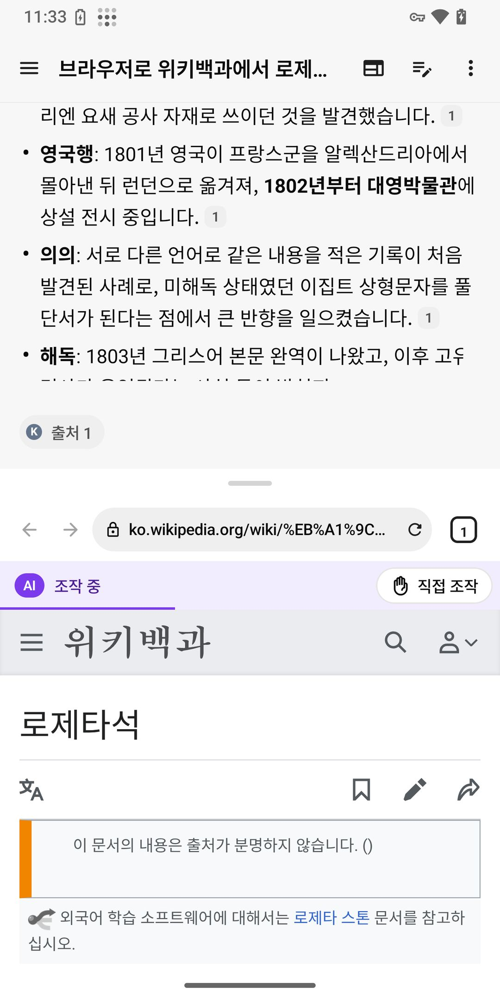
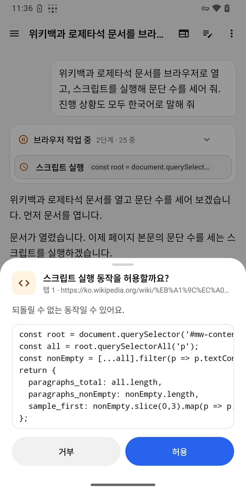
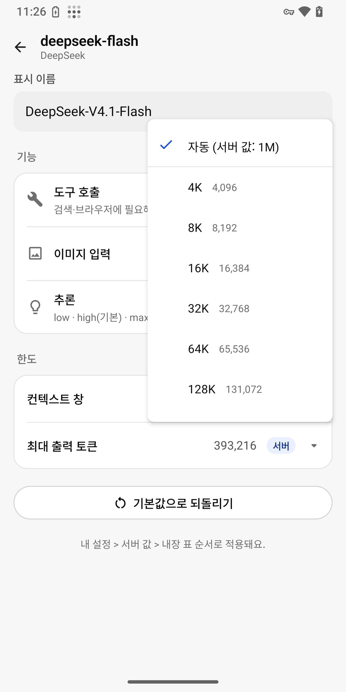
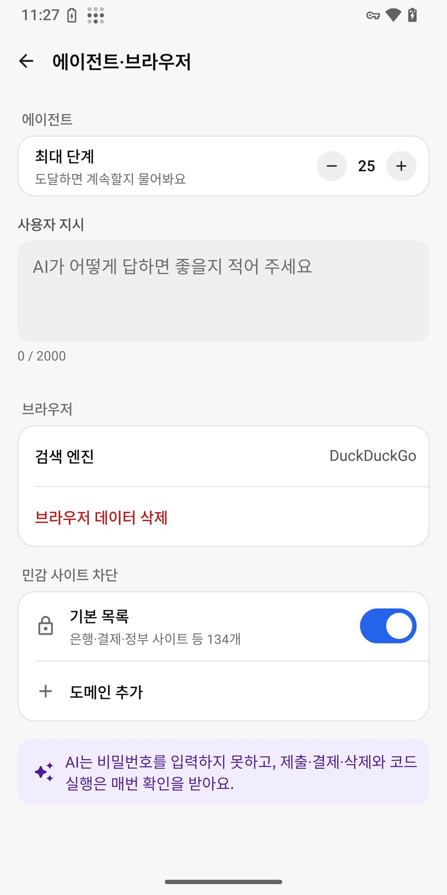

<p align="center">
  
</p>

<h1 align="center">localchat</h1>

<p align="center">내 API 키로 OpenAI 호환 모델에 직접 연결하는 Android 채팅 앱.<br>AI가 앱 안의 브라우저를 직접 조작하고, 위험한 동작은 매번 사용자에게 묻습니다.</p>

<table>
  <tr>
    <td></td>
    <td></td>
    <td></td>
    <td></td>
    <td></td>
  </tr>
  <tr>
    <td align="center">검색 답변 · 출처</td>
    <td align="center">AI 브라우저</td>
    <td align="center">실행 전 확인</td>
    <td align="center">모델별 한도</td>
    <td align="center">민감 사이트 차단</td>
  </tr>
</table>

## 설치

1. [Releases](https://github.com/ouor/localchat/releases)에서 `localchat-v1.0.1-arm64-v8a.apk`를 받아 설치합니다.
   Android 12 이상, arm64 기기용입니다. (Play 스토어 앱이 아니므로 "출처를 알 수 없는 앱" 설치 허용이 필요할 수 있어요.)
2. 첫 화면에서 프로바이더를 고르고 API 키를 넣습니다. DeepSeek · OpenAI · OpenRouter · Ollama · LM Studio 프리셋이 있고,
   그 밖의 서버는 **직접 입력**(OpenAI 호환 서버)으로 기본 URL을 넣으면 됩니다.

계정 가입도, 저희 서버도 없습니다. 사용 요금은 각자 프로바이더에 냅니다.

## 특징

### 어떤 OpenAI 호환 서버에도 직접 연결
- 프로바이더를 여러 개 등록할 수 있고, 모델 선택 시트는 프로바이더별로 묶여 보입니다.
- 모델마다 **컨텍스트 창**과 **최대 출력 토큰**을 정할 수 있습니다. 값마다 출처(`서버` · `기본값` · 내 설정)가 표시되고,
  "내 설정 > 서버 값 > 내장 표" 순서로 적용됩니다. 도구 호출 · 이미지 입력 · 추론 지원 여부도 모델별로 켜고 끌 수 있습니다.
- `http` 주소(예: 같은 와이파이의 Ollama)는 프로바이더마다 따로 허용해야 쓸 수 있습니다.

### AI가 직접 쓰는 앱 안 브라우저
- AI가 탭을 열고, 읽고, 누르고, 입력하고, 스크롤합니다. 작업 중에는 채팅 아래에 한 줄 상태 표시가 뜨고,
  누르면 패널이 절반 높이로 열립니다. 패널은 끌어서 절반/전체로 바꿀 수 있습니다.
- **직접 조작**을 누르면 AI는 그 탭에서 기다리고, 로그인처럼 사람이 해야 하는 일은 AI가 먼저 넘겨 달라고 요청합니다.
- 도구 호출을 못 하는 모델이라도 질문에 링크를 넣으면 앱이 페이지를 읽어 첨부해 줍니다.

### 브라우저 안전장치
- AI는 비밀번호 · 인증번호(OTP) · 카드번호 · 보안코드 칸에 입력하지 못하고, 그 값을 읽지도 못합니다.
  결제 위젯처럼 내용을 확인할 수 없는 프레임에도 입력하지 않습니다.
- 다음 동작은 **매번** 사용자의 허용을 받습니다: POST 양식 제출, "결제 · 주문 · 삭제 · 전송 · 송금 · 탈퇴" 같은 버튼,
  확인 대화상자 수락, `http` 페이지에서의 입력, 그리고 AI가 쓴 스크립트 실행(실행할 코드 전체를 보여 줍니다).
- **민감 사이트 차단**: 은행 · 결제 · 정부 사이트 등 기본 목록(134개 도메인)에서는 AI가 페이지를 읽거나 조작하지 못합니다.
  도메인을 직접 추가할 수 있고, 기본 목록은 끌 수 있습니다(끄더라도 입력 금지와 실행 전 확인은 그대로입니다).
- AI가 연속으로 진행하는 단계 수에 상한이 있고(기본 25), 도달하면 계속할지 묻습니다.

### 출처가 붙는 웹 검색
- 검색은 DuckDuckGo(기본) · Google · Bing · Naver 결과 페이지를 앱의 브라우저로 직접 읽습니다. 별도 검색 API 키가 필요 없습니다.
- 답변 본문에 번호 배지로 인용이 붙고, 답변 아래 **출처** 칩을 누르면 출처 목록이 열립니다.

### 긴 대화 자동 요약
- 입력창 위 옵션을 열면 모델 줄 끝의 게이지가 컨텍스트 사용량을 보여 줍니다. 80%를 넘으면 다음 전송 때 오래된 기록을 자동으로 요약하고
  (최근 질문 두 개는 그대로 둡니다), 서버가 길이 초과로 거절해도 한 번 요약한 뒤 다시 보냅니다. **지금 요약**으로 직접 할 수도 있습니다.

### 문서 첨부
- PDF와 Word · Excel · PowerPoint(`docx` · `xlsx` · `pptx`), 텍스트 · 코드 파일은 기기에서 텍스트를 뽑아 보냅니다.
  이미지는 줄여서 보냅니다(이미지 입력을 지원하는 모델). 다른 앱의 공유하기로도 넣을 수 있습니다.

### 백업과 가져오기
- **설정 → 데이터**에서 전체 백업(ZIP)과 대화 하나 내보내기를 할 수 있습니다.
- **API 키 포함**을 고르면 키만 비밀번호로 암호화해 넣습니다(PBKDF2 + AES-256-GCM). 대화와 첨부는 암호화되지 않은 일반 ZIP입니다.
  비밀번호를 잊으면 키는 복구할 수 없고, "키 없이 복원"은 가능합니다.
- DeepSeek에서 내보낸 대화 기록 ZIP도 같은 **파일에서 복원**으로 가져올 수 있습니다.

## 데이터와 개인정보

- 대화 · 첨부 · 설정은 이 기기의 앱 저장소에만 있습니다. API 키는 Android Keystore로 암호화해 저장하고 다시 보여 주지 않습니다.
- 기기 클라우드 자동 백업은 꺼져 있습니다. 기기를 옮기거나 앱을 지우기 전에는 **설정 → 데이터 → 백업**으로 파일을 만들어 두세요.
- 기기 밖으로 나가는 요청:
  - 메시지와 첨부: 사용자가 등록한 프로바이더 서버로만
  - 웹 검색: 고른 검색 엔진으로 검색어
  - 브라우저와 링크 읽기: 그 페이지가 있는 사이트로
  - 음성 입력 · 소리 내어 읽기: 기기에 설치된 음성 인식 · TTS 엔진을 사용
- 분석 · 광고 · 오류 수집 SDK는 들어 있지 않습니다.

## 소스에서 빌드

```
./gradlew assembleDebug
```

JDK 21과 Android SDK가 필요합니다.
