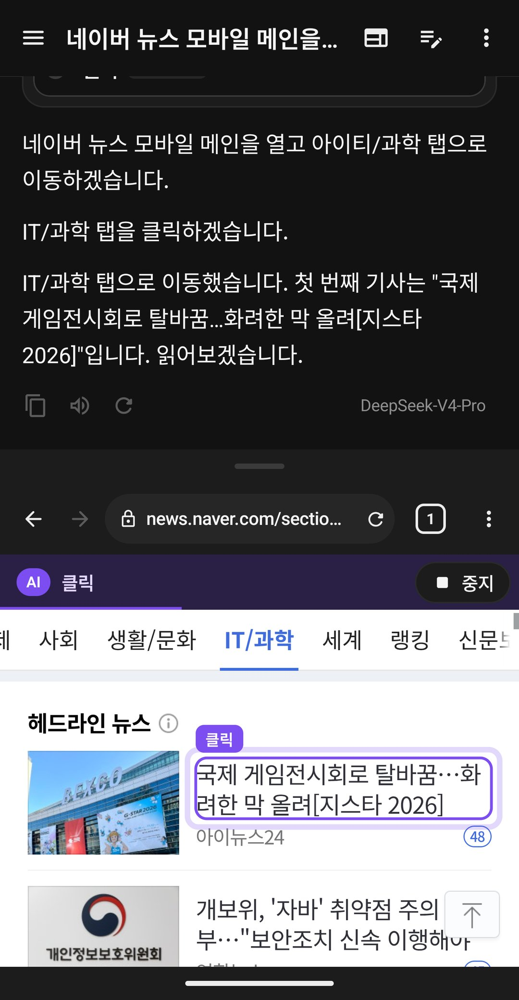
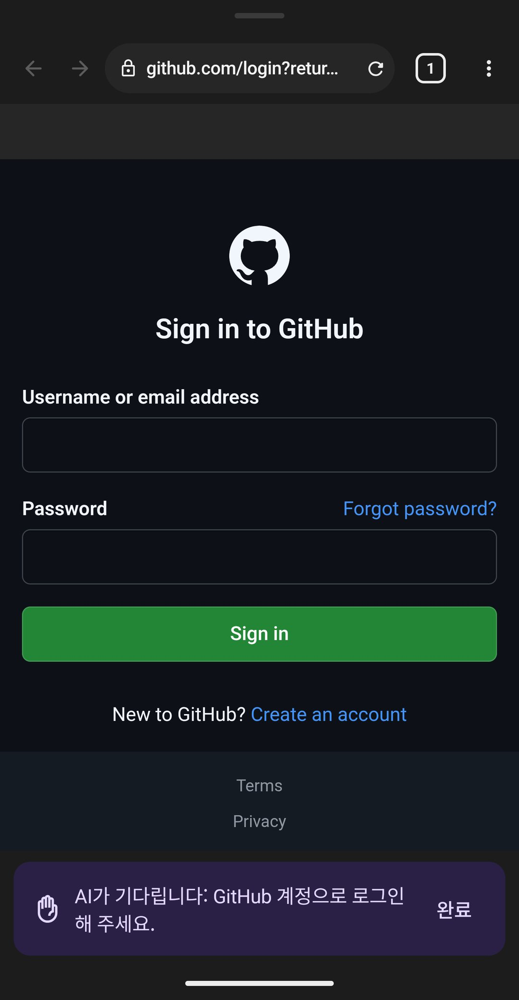
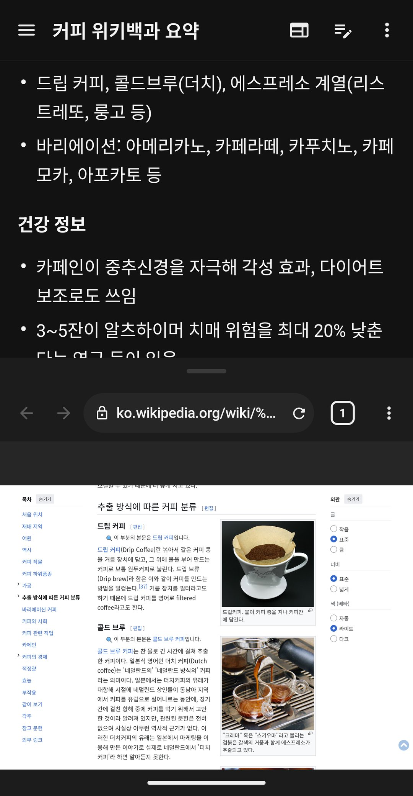
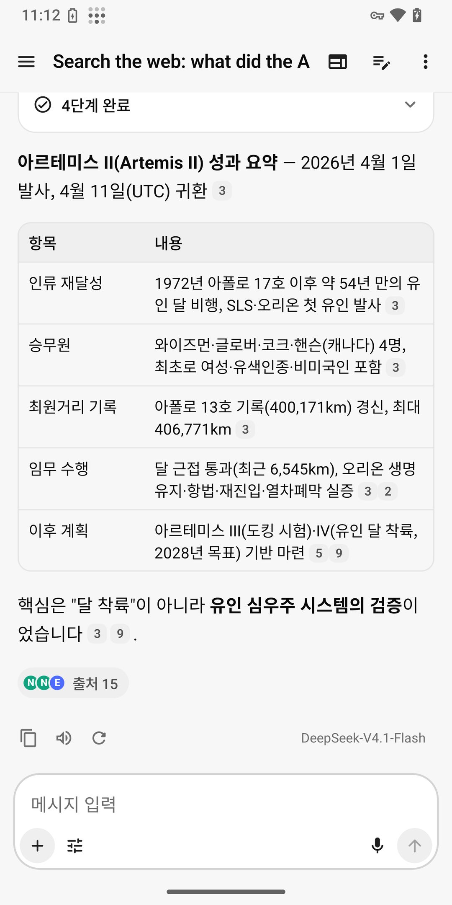

<p align="center">
  
</p>

<h1 align="center">localchat</h1>

<p align="center"><b>English</b> · <a href="README.ko.md">한국어</a></p>

<p align="center">An Android chat app whose AI browses the web in a real browser on your own phone.<br>You sign in where a page needs it; the AI does the reading and the legwork.</p>

<table>
  <tr>
    <td></td>
    <td></td>
    <td></td>
    <td></td>
    <td></td>
  </tr>
  <tr>
    <td align="center">Live page browsing</td>
    <td align="center">You sign in</td>
    <td align="center">Reads your tab</td>
    <td align="center">Answers with sources</td>
    <td align="center">Per-model limits</td>
  </tr>
</table>

<p align="center"><sub>Screenshots show the Korean UI. The app follows your device language (English and Korean).</sub></p>

## What makes it different

### 1. It browses from your phone, not a data center
AI tools that fetch the web from a server use data-center IPs, so they keep running into bot blocks, CAPTCHAs and access denials.
localchat's AI opens pages **from your phone's own network, in a real mobile browser (WebView)**.
To a site it looks like an ordinary visitor on a phone, so sites that turn server-side tools away open as usual.
Search needs no search API either: the app reads the DuckDuckGo, Google, Bing or Naver results page directly.

### 2. It really loads the page
Many pages give `curl` or a batch fetcher nothing but an empty shell. localchat loads the page in a browser, waits until its scripts have finished drawing it, and then reads it.
- Pages drawn by JavaScript, and single-page apps whose address never changes as you move around
- Feeds that load more as you scroll, and scroll areas inside a page
- Content behind buttons, tab widgets, search-box suggestions
- Long articles read to the end, and links opened in new tabs to compare

### 3. You sign in, the AI takes it from there
When a page needs a login, the AI asks you in an **"AI is waiting for you"** banner. Sign in yourself in the browser drawer, tap **Done**, and the AI picks up right where it was.
You type the password, not the AI. The login stays in the browser, so sites you are already signed in to are ready for the AI to use.

### One browser, shared by you and the AI
- Tabs the AI opens and tabs you open live in the same browser. Ask "summarize the tab I'm looking at" and it reads from where you are.
- The AI opens tabs, reads, taps, types, scrolls, goes back, and runs a script when it needs to. Tabs it opened stay, so the next question can pick them up.
- The AI working never changes what you are looking at. The tab it is working on shows in the drawer's activity bar.
- Tabs left unused go to sleep to save memory, and wake up with their back/forward history when used again.
- Downloads (PDF, CSV, export buttons) are saved to Downloads, and the AI is told exactly whether the file was saved.

## Install

1. Download `localchat-v1.0.3-arm64-v8a.apk` from [Releases](https://github.com/ouor/localchat/releases/latest) and install it.
   It needs Android 12 or later on an arm64 device. (It is not a Play Store app, so you may need to allow installing apps from unknown sources.)
2. On the first screen, pick a provider and enter your API key. There are presets for DeepSeek, OpenAI, OpenRouter, Ollama and LM Studio;
   for any other server, choose **Enter manually** (any OpenAI-compatible server) and enter its base URL.

No sign-up and no server of ours. You pay your provider directly for what you use.

## Confirmations only where they matter

- While the AI works, the only confirmations are for **buttons that spend money** (pay, order, transfer and the like) and **account deletion**. The confirmation shows the form the button belongs to.
- Everything else is protected quietly:
  - Values in password, one-time-code and card fields are never sent to the AI model.
  - Cookie values that appear in page content are masked.
  - **Sensitive site block**: the AI does not read a built-in list of 134 domains (mail, cloud documents, account management, password managers and more).
    To let the AI work with your mail or documents, turn it off under **Settings → Agent and browser → Protections**; you can also add your own domains.
- The number of steps the AI takes in a row is capped (25 by default); at the cap it asks whether to continue.

## Other features

### Connect straight to any OpenAI-compatible server
- Register several providers; the model picker groups models by provider.
- Set the **context window** and **max output tokens** per model. Each value shows where it came from (`server`, `default`, or your setting),
  applied in the order "your setting > server value > built-in table". Tool calling, image input and reasoning support can be switched per model.
- `http` addresses (for example Ollama on the same Wi-Fi) must be allowed per provider.
- Even with a model that cannot call tools, a link in your question is read in the browser and attached for you.

### Answers with sources
- Citations appear as numbered badges in the answer; tap the **Sources** chip under the answer to see the list.

### Automatic summaries for long chats
- Open the options above the input box to see a context gauge at the end of the model row. Past 80%, the next send summarizes older history automatically
  (the last two questions stay as they are), and if the server still rejects the request as too long, it summarizes once and resends. **Summarize now** does it on demand.

### Document attachments
- Text is extracted on the device from PDF, Word, Excel and PowerPoint (`docx`, `xlsx`, `pptx`) and from text and code files.
  Images are downscaled (for models with image input). You can also share files in from other apps.

### Backup and import
- **Settings → Data** offers a full backup (ZIP) and exporting a single chat.
- With **Include API keys**, only the keys are encrypted with a password (PBKDF2 + AES-256-GCM). Chats and attachments are a plain, unencrypted ZIP.
  A forgotten password means the keys cannot be recovered, but you can still **Restore without keys**.
- Chat history ZIPs exported from DeepSeek can be imported through the same **Restore from file**.

## Known limits

- Google account sign-in (including "Sign in with Google") does not work: Google blocks in-app browsers. Sites' own username/password logins and popup logins work.
- PDFs are saved to Downloads, but their text cannot be read inside the browser.
- Once in a while a site shows a human check (CAPTCHA); the AI then asks you to solve it.

## Data and privacy

- Chats, attachments and settings stay in the app's storage on this device. API keys are encrypted with the Android Keystore and never shown again.
- Device cloud backup is off. Before moving to another device or uninstalling, make a backup file under **Settings → Data → Backup**.
- Requests that leave the device:
  - Messages, attachments and page content the AI read: only to the provider servers you registered
  - Web search: the query, to the search engine you chose
  - Browser and link reading: to the site the page is on (straight from your phone)
  - Voice input and read-aloud: the speech recognition and TTS engines installed on the device
- No analytics, advertising or crash-reporting SDKs are included.

## Build from source

```
./gradlew assembleDebug
```

Requires JDK 21 and the Android SDK.
